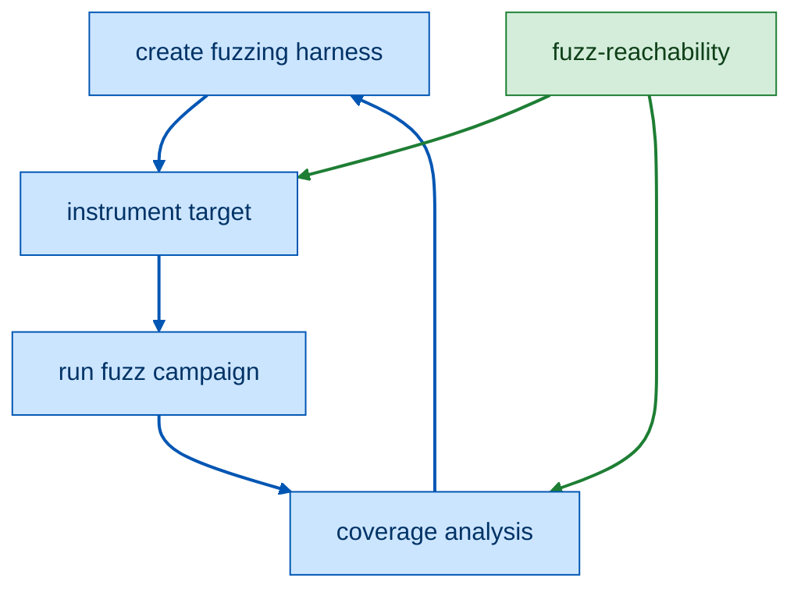

# Static Fuzz-Reachability Analyzer (C / C++ / Rust)

Given a project's build, this tool computes the set of functions a fuzz entry
point (`LLVMFuzzerTestOneInput`, a Rust cargo-fuzz target, or any entry you name)
can **statically reach**. It works uniformly across C, C++, and Rust — including
mixed-language projects — by analyzing merged LLVM bitcode.

The result is a **sound-leaning over-approximation**: it answers *which functions
can be reached*, not which ones ran. No function that is actually reachable is
ever reported unreachable. Over-reporting is expected and safe; under-reporting
is a bug.

**Deep dives:**
- Worked examples, step by step — a generic `LLVMFuzzerTestOneInput` harness for AFL++/libfuzzer (libxml2), a ziggy harness (the `url` crate), and cargo-afl harnesses (cpp_demangle and rustyknife) — [`docs/EXAMPLES.md`](docs/EXAMPLES.md)
- LLVM version support — [`docs/llvm-support.md`](docs/llvm-support.md)

Version: 1.2-dev

Author: Marc "vanHauser" Heuse

License: GNU AGPL v3 or newer


## How to use in a fuzzing campaign


### Instrument fuzzing target

Use the reachability information to only instrument what is reachable.
**Note that this is pointless in full link time optimization targets** (C/C++: `afl-clang-lto` or `-flto=full`, Rust: default) because this is already done by the compiler.

For AFL++ (AFL++ native LLVM plugins):
```
export AFL_LLVM_ALLOWLIST=$(pwd)/reached.txt
make/meson/ninja/cmake/...
```

For sancov (AFL++ sancov, libfuzzer, honggfuzz, etc.):
```
export CFLAGS="-fsanitize-coverage-allowlist=$(pwd)/reached.txt"
export CXXFLAGS="-fsanitize-coverage-allowlist=$(pwd)/reached.txt"
make/meson/ninja/cmake/...
```

#### Allowlist vs ignorelist — which is safe when bitcode is incomplete

Both lists are derived from the same reachable set (a sound-leaning
over-approximation). But when the analyzed bitcode is **incomplete** — a
precompiled library, the Rust standard library without `--build-std`, or an
assembly-only translation unit — a function can be genuinely reachable and
still have no body anywhere in the merged bitcode. Such a function shows up as
an `external_declarations` entry, not as a reachable function with a call
graph. Both list generators skip bodyless functions identically; it is the
allowlist-vs-ignorelist *semantics* whose consequence differs:

- **Allowlist (`reached.txt`)** only lists reachable functions that have a
  body in the bitcode. A reachable function with no body is **absent** from
  it, so `AFL_LLVM_ALLOWLIST=reached.txt` /
  `-fsanitize-coverage-allowlist=reached.txt` never instruments it — a
  coverage **blind spot** for code that genuinely runs.
- **Ignorelist (`not_reached.txt`)** only lists functions *proven*
  unreachable. The same bodyless function is not proven unreachable, so it is
  never added there, and `-fsanitize-coverage-ignorelist=not_reached.txt`
  still instruments it — *provided the coverage build actually compiles that
  function from source with the coverage pass*. For a genuinely precompiled
  library or an assembly-only unit there is no source recompiled through the
  instrumenting toolchain, so neither list recovers it: it stays
  uninstrumented under either flag.

**Recommendation:** default to the **ignorelist** as the conservative choice —
it can never exclude more than the allowlist would include, so it never turns
a reachable-but-bodyless function into a blind spot on its own. An LTO-free
build, `--static-libs auto` (the default, which analyzes each linked
bitcode-carrying archive in full), and, for Rust, `--build-std` all *shrink*
the external set — but they do not guarantee completeness. `--static-libs
auto` only recovers members of an archive that was itself compiled to bitcode
(via gllvm); it cannot manufacture bitcode for a binary blob or an asm-only
unit that was never compiled that way. Precompiled libraries and
assembly-only units therefore remain inherent limits (see
[Limitations](#limitations)). Check `summary.external_declarations` in the
JSON report (and the top-level `external_declarations` array, which names
them): a nonzero count means some reachable code sits outside the analyzed
bitcode regardless of flags, and no list can instrument what no build compiles
through the coverage pass.

### Coverage analysis

Use with [cov-analysis](https://github.com/AFLplusplus/cov-analysis) to see:
- what is reachable but not reached yet by the fuzzing corpus
- what is unreachable by the harness but should be fuzzed

```
cov-analysis report -d ../target-afl/out -e ./harness-cov -T 4 --reachability reachability.json
```


## How it works

```
   driver (Python)                   analyzer (C++ / LLVM)
   ───────────────                   ─────────────────────
   acquire bitcode ─┐
   C/C++ : gllvm    │   llvm-link    load .bc → build call graph →
   Rust  : rustc    ├─► merge .bc ─► resolve indirect calls → BFS from
   --emit=llvm-bc  ─┘                entry → JSON report + sancov lists
```

Two components, joined by merged bitcode:

- **Driver** (Python) — acquires bitcode per language, merges it with
  `llvm-link`, verifies the LLVM toolchain is version-coherent, and runs the
  analyzer.
- **Analyzer** (C++ linking LLVM) — loads the merged `.bc`, promotes stack slots
  to SSA registers (`mem2reg`; it deletes no function) so value flow can follow
  pointers through `-O0` code, builds the call graph, resolves indirect calls (C
  function pointers, C++ virtual dispatch, Rust `dyn`/`fn` pointers), treats
  function pointers that escape to code outside the bitcode (handed to an
  external/indirect call, returned, or stored into memory that external code
  owns — e.g. qsort/bsearch comparators, atexit/pthread/`std::call_once`
  callbacks, error-hook variables, hook tables a library returns) as reachable,
  computes reachability from the entry, and emits a JSON report plus the two
  sancov lists. It demangles C++ (Itanium) and Rust names.

## Prerequisites

- **LLVM ≥ 21.** One coherent toolchain: `clang`, `clang++`, `llvm-link`,
  and the analyzer all share one major **M ≥ 21**, and rustc's LLVM is no newer
  than M. See [`docs/llvm-support.md`](docs/llvm-support.md).
  **NOTE!** especially as a Rust user, we recommend to install LLVM via
  https://apt.llvm.org/llvm.sh instead of the distribution, as those will be outdated!
- **Go** (to install `gllvm`), **Python ≥ 3.10**, and a **C++17** compiler. Rust
  targets also need **rustc / cargo** (nightly, using the same or older version of LLVM you are using).
- [AFL++](https://github.com/AFLplusplus/AFLplusplus) compiled from commit 01a83a3d7098e605f0c7fd69381fcf4fc97144fe onwards (24 June 2026)
- [cov-analysis](https://github.com/AFLplusplus/cov-analysis) from commit 07e7afc63a54f593a377556b8f6f6144f1f7dc08 onwards (8 July 2026)

## Install

The analyzer builds with a plain Makefile driven by `llvm-config` — no CMake.

```bash
bash scripts/setup.sh        # gllvm + rust-src, create .venv, build the analyzer
```

Or piecemeal:

```bash
make venv                    # create .venv (driver, editable + pytest)
make build                   # build the analyzer on the auto-selected LLVM (≥ 21)
make build LLVM_MAJOR=23     # ...or pin a specific major
make test                    # run the full test suite
make matrix                  # build + test against every installed LLVM ≥ 21
make compdb                  # generate analyzer/compile_commands.json for clangd
make static-analysis         # run cppcheck + Clang Static Analyzer
make help                    # list all targets
```

Setup installs the pinned gllvm 1.3.1 and Python test dependencies from
`requirements-dev.txt`; it does not upgrade pip implicitly. `make matrix`
discovers versioned `llvm-config-*` programs anywhere on `PATH` and fails when
none are available. An explicitly optional local probe can set
`MATRIX_ALLOW_EMPTY=1` to report a skip instead.

To run the CLI, point it at the built analyzer and put `gllvm` on `PATH`:

```bash
export REACHABILITY_ANALYZER=$PWD/analyzer/build/reachability-analyzer
export PATH="$(go env GOPATH)/bin:$PATH"     # gclang / gclang++ / get-bc
source .venv/bin/activate                    # or call .venv/bin/reachability directly
reachability check-toolchain                 # verify LLVM version coherence first
```

## Quick start

```bash
reachability run --lang <target> --project <dir> [--out <file>]
```

`--out` is optional; it defaults to `reachability.json` in the `--project`
directory. `--out`, `--reached`, `--not-reached`, and `--dot` always name files;
an existing directory is rejected before anything is removed or built. The
destinations must be distinct after absolute and symlink resolution.

All requested outputs are staged beside their final destinations and published
as one transaction after acquisition, linking, analysis, and validation succeed.
A failed run preserves the complete previous output set (or leaves no new set),
and each invocation keeps extracted bitcode and `merged.bc` in its own temporary
directory, so concurrent runs in one project do not share intermediates.

`<target>` is a source language (`c`, `cpp`, `rust`, `mixed`) or a Rust fuzz
harness (`libfuzzer`, `ziggy`, `afl`). Each sets a default entry point, so the
common case needs no `--entry`. The build command and the artifact are
auto-detected for C/C++; override them with `--build-cmd` / `--artifact` when
needed.

Full options: [Command-line reference](#command-line-reference).

## Examples

Read about real-world target examples in [docs/EXAMPLES.md](docs/EXAMPLES.md)

### A C target

`fixtures/c_direct` is a small C fuzz target. Its build and artifact are
auto-detected:

```bash
reachability run --lang c --project fixtures/c_direct -v
```

```
reachable 3 / defined 4  (0 indirect-only, 0 low-confidence, 1 unreachable)  [backend=type-based]
```

`LLVMFuzzerTestOneInput → used_a → used_b` are reachable; `dead_fn` lands in
`unreachable_defined`.

### A C++ target (CMake)

`examples/cpp_cmake` uses virtual dispatch. The driver detects the CMake build,
wraps it with `gllvm`, and analyzes the resulting executable:

```bash
reachability run --lang cpp --project examples/cpp_cmake -v
```

The virtual call `Codec::decode` over-approximates to **both** overrides, reached
via indirect edges:

```
  Raw::decode(unsigned char const*, unsigned long) | via indirect
  Xor::decode(unsigned char const*, unsigned long) | via indirect
```

### A Rust target

`fixtures/rust_dyn` is a Rust `staticlib` whose `LLVMFuzzerTestOneInput`
dispatches through a `dyn Trait`. The driver builds it with
`RUSTFLAGS="--emit=llvm-bc …"` and collects the per-crate bitcode:

```bash
reachability run --lang rust --project fixtures/rust_dyn -v
```

The trait-object call resolves to both implementations, via indirect edges:

```
  <rust_dyn::Inc as rust_dyn::Op>::run | via indirect
  <rust_dyn::Dbl as rust_dyn::Op>::run | via indirect
```

### A mixed C + Rust target (cargo-fuzz shape)

`fixtures/mixed_c_rust` has C++ glue calling an `extern "C"` Rust entry. Use
`--lang mixed`; the driver builds and merges both sides' bitcode (gllvm for the
glue, cargo for Rust), and the cross-language edge resolves by C-ABI symbol name:

```bash
reachability run --lang mixed --project fixtures/mixed_c_rust \
  --artifact glue.o -v
```

Point `--artifact` at the C/C++ object so it is picked out from the Rust build
outputs.

### A target that links a static library

A tool linked against a static library (say `tools/thumbnail` linking
`libtiff.a`) embeds only the archive members the linker actually pulled in. To
analyze the **whole library** — not just the slice the linker kept — point
`--artifact` at the linked binary and keep the default `--static-libs auto`:

```bash
reachability run --lang c --project tiff-4.0.4/ --artifact tools/thumbnail -v
```

The driver merges `thumbnail`'s own objects with the full contents of
`libtiff.a`. Functions in members the linker discarded (e.g. `TIFFReadRGBAImage`,
`TIFFPrintDirectory`) now show up as unreachable instead of vanishing, while the
reachable set is unchanged from the linker's view — adding the rest of the
library can only add *unreachable* functions, never remove reachable ones. Use
`--static-libs none` for the linker's view only, or `all` to include every
bitcode archive in the tree.

### A ziggy harness

A [ziggy](https://github.com/srlabs/ziggy) harness is a Rust binary whose fuzz
loop lives in `main` rather than in `LLVMFuzzerTestOneInput`. `--lang ziggy`
builds it with its own driver (`cargo ziggy build --no-honggfuzz`) and roots at
`main` automatically:

```bash
reachability run --lang ziggy --project project/ziggy-harness/
```

Building through the fuzzer's own command (likewise `cargo afl build` for
`--lang afl`, `cargo fuzz build` for `--lang libfuzzer`) is deliberate: it sets
the same `cfg(fuzzing)`, optimization level, and instrumentation as the binary
you actually fuzz, so the reachable set matches it. Override the command with
`--build-cmd` (e.g. to pick a profile, sanitizer, or single target).

> For complete, start-to-finish walkthroughs on real targets — ziggy (the `url`
> crate), cargo-afl (cpp_demangle and rustyknife), and libFuzzer (libxml2)
> harnesses — see [`docs/EXAMPLES.md`](docs/EXAMPLES.md).

## Command-line reference

The `reachability` CLI has two subcommands.

### `reachability check-toolchain`

Resolves and validates the LLVM toolchain (analyzer, `clang`/`clang++`,
`llvm-link`, `rustc`) for version coherence and prints what it found. Run it
first; it exits non-zero on any incoherence. See
[`docs/llvm-support.md`](docs/llvm-support.md) for the policy.

`rustc` is checked **only when it is installed**: on a host with no Rust
toolchain the command reports `no rustc on PATH (Rust targets unavailable; C/C++
ready)` and exits zero, since the Rust LLVM-coherence rule cannot apply to a
C/C++ target. An installed `rustc` whose bundled LLVM is newer than the
analyzer's is still a fatal incoherence.

### `reachability run`

Builds a project, merges its bitcode, and computes the reachable set from the
entry point(s).

| Option | Default | Meaning |
|--------|---------|---------|
| `--project DIR` | *(required)* | Project directory to build and analyze. |
| `--lang TARGET` | *(required)* | Target type (see the table below): sets how bitcode is acquired and the default entry. |
| `--out FILE` | `reachability.json` in `--project` | File path for the JSON report. Existing directories are rejected. The two sancov lists default to `reached.txt` / `not_reached.txt` beside it. |
| `--entry NAME` | per `--lang` | Entry to root reachability at. **Repeatable**; overrides the target default. See [Entry resolution](#entry-resolution). |
| `--include-process-lifecycle-roots` | off | Also root `llvm.global_ctors`, `llvm.global_dtors`, and ifunc resolvers. (`LLVMFuzzerInitialize` and callbacks that constructors hand to external code are rooted without this flag.) See [Process-lifecycle roots](#process-lifecycle-roots). |
| `--backend NAME` | *(none)* | Deprecated and ignored; the type-based backend is always used. Accepted for backward compatibility — passing it prints a warning. |
| `--artifact PATH` | auto-detect | C/C++ only: a strict built binary/object/archive target (relative to `--project`). A missing, unsupported, or unextractable explicit path fails; automatic discovery runs only when the option is omitted. Discovery prefers executables over shared libraries, archives, then objects, and requires `--artifact` when equally plausible candidates remain. |
| `--build-cmd CMD` | auto-detect | Shell build command. C/C++: run with `gllvm` injected, auto-detected otherwise (`configure` → `Makefile` → `CMakeLists.txt` → `build.ninja` → `meson.build`, else `make`); e.g. `"cmake -S . -B build && cmake --build build"`. Auto-detected CMake and Meson builds configure into a tool-owned `build-reachability/` directory, never the project's own `build/`: both tools ignore a changed `CC`/`CXX` once a build directory exists, so reusing yours would silently skip gllvm and write the options below into your cache. An auto-detected build is forced static where the build system allows it (shared libraries are linked separately, so their bitcode never reaches the target): `--disable-shared`/`--enable-static` for `configure` when `configure --help` lists them, `-DBUILD_SHARED_LIBS=OFF` for CMake, `--default-library=static` for Meson. An auto-detected build also disables link-time optimization, since gllvm cannot embed bitcode under `-flto`: `-DCMAKE_INTERPROCEDURAL_OPTIMIZATION=OFF` for CMake, `-Db_lto=false` for Meson, and `--disable-lto` for `configure` when its `--help` lists an LTO toggle. If bitcode extraction still fails, the error names the likely cause (LTO, an afl-clang-fast/clang-LTO binary, a ccache/sccache layer, or assembly-only units) and its fix. Pass `--build-cmd` to override this entirely. `libfuzzer`/`ziggy`/`afl`: overrides the native build command (default `cargo fuzz build` / `cargo ziggy build --no-honggfuzz` / `cargo afl build`). |
| `--static-libs {auto,none,all}` | `auto` | C/C++ only: how to treat static archives (`.a`) the target links. `auto` also analyzes each linked archive in full, so members the linker dropped are reported rather than silently absent. `none` keeps only the linker's view. `all` includes every bitcode archive in the tree. Exact archive manifests prevent linked objects from being dropped. Requested expansion fails closed if any archive cannot be listed or fully extracted, so an incomplete report is never published as complete. |
| `--profile {debug,release}` | tool default | Build profile. `libfuzzer`/`ziggy`/`afl`: `release` adds `--release` to the native command (else the tool's default). Plain `--lang rust`: the cargo profile (default `debug`). See [Matching the fuzz binary's build](#matching-the-fuzz-binarys-build). |
| `--codegen-units N` | auto | Plain `--lang rust` only (positive integer): rustc `-Ccodegen-units`, auto-detected from `Cargo.toml` else cargo's per-profile default. Ignored for `libfuzzer`/`ziggy`/`afl` (their build sets it). See [Matching the fuzz binary's build](#matching-the-fuzz-binarys-build). |
| `--optimize` | off | Build the analysis at the target's real optimization (post-inline). By default the analysis build is **source-faithful**: C/C++ analysis bitcode is built with `-O0 -fno-inline -fno-inline-functions` (via `LLVM_BITCODE_GENERATION_FLAGS`, which gllvm applies to the bitcode compile only — the native object keeps the project's own `-Ox`); Rust with `-Copt-level=0` (via composed `RUSTFLAGS` for plain `--lang rust`/`mixed`, or via `RUSTC_WRAPPER` for native harnesses). No function the source defines is optimized away, so the reachable set matches what `llvm-cov` reports and is a safe allowlist superset. An inherited `LLVM_BITCODE_GENERATION_FLAGS` that already sets an `-O` level keeps it — the escape hatch for a unit that only compiles optimized; only the no-inlining flags are then added. For native Rust harnesses (`libfuzzer`/`ziggy`/`afl`), `--optimize` also skips the post-analysis clean (otherwise their throwaway opt-0 build is discarded). Pass `--optimize` when you want the set and per-function metrics to mirror a specific `-O3` instrumented binary. LTO is stripped either way. |
| `--no-name-roots` | off | Do not root a defined, externally-visible function whose symbol name appears as a string constant in a module that performs a runtime name lookup. The heuristic is on by default and disabling it **can under-report**; its use is measuring how much of the reachable set it contributes. See [Reachability through runtime symbol lookup](#reachability-through-runtime-symbol-lookup). |
| `--build-std` | off | Rust only: build the standard library from source with Cargo's `-Zbuild-std` option and rustc's detected host target, so std functions appear in the graph instead of as external declarations. |
| `--mangling {auto,legacy,v0}` | `auto` | Rust only: the symbol-mangling scheme of the analysis build; `legacy`/`v0` append `-Csymbol-mangling-version=<v>` (`legacy` needs a nightly rustc). See [Matching the fuzz binary's build](#matching-the-fuzz-binarys-build). |
| `--clean` | off | Validate every selected output first, then remove those files and tool-owned build state before rebuilding. Rust uses `cargo clean` (also in `fuzz/` for cargo-fuzz). C/C++ removes the tool-owned `build-reachability/` directory, runs configured build-system clean targets, and removes only artifacts recorded in `.reachability-cache/owned-c-artifacts.json`; unrelated `.o`, `.bc`, and manifest files are not swept recursively. |
| `--dot FILE` | *(none)* | Also write the deterministic reachable-defined subgraph as Graphviz DOT (indirect edges dashed/red; bodyless declarations remain in the JSON `external_declarations` list rather than as DOT nodes). |
| `--no-edges` | off | Omit the `edges` array from the JSON report. Its size grows with call sites × indirect targets, so on code with large dispatch tables it dominates both the report size and the run time. |
| `--reached FILE` | beside `--out` | Path for the sancov **allowlist** of reachable functions. |
| `--not-reached FILE` | beside `--out` | Path for the sancov **ignorelist** of unreachable functions. |
| `-v`, `--verbose` | off | Narrate each pipeline stage (toolchain → build → merge → analyze): echoes the tool commands run, streams the build output live, and lists the collected bitcode modules. |

#### Target types (`--lang`)

| `--lang` | acquires via | default entry |
|----------|--------------|---------------|
| `c` | gllvm (`gclang`) | `main` + `LLVMFuzzerTestOneInput` |
| `cpp` | gllvm (`gclang++`) | `main` + `LLVMFuzzerTestOneInput` |
| `rust` | `cargo build` + `--emit=llvm-bc` | `main` |
| `mixed` | gllvm **and** cargo (merged) | `LLVMFuzzerTestOneInput` |
| `libfuzzer` | `cargo fuzz build` | `fuzz_target!` |
| `ziggy` | `cargo ziggy build --no-honggfuzz` | `main` |
| `afl` | `cargo afl build` | `main` |

`libfuzzer`/`ziggy`/`afl` build through the fuzzer's own driver (a `RUSTC_WRAPPER`
adds `--emit=llvm-bc`), so the bitcode carries the real `cfg(fuzzing)`, opt level,
and instrumentation; `--build-cmd` overrides the command. `rust`/`mixed` use a
plain `cargo build`, tunable with `--profile` / `--codegen-units`.

The C/C++ targets root at both `main` and `LLVMFuzzerTestOneInput`, so one
`--lang c`/`cpp` covers a normal program and an `LLVMFuzzerTestOneInput` harness alike. A default
entry that matches nothing is a harmless warning, because roots are unioned.

#### Entry resolution

`--entry` never requires a mangled symbol. A token matches — unioned across all
of:

- an exact mangled symbol (e.g. `_Z3foov`),
- an exact demangled name (e.g. `foo()`),
- a demangled `::name` suffix (so `main` finds `crate::main`), and
- the alias `fuzz_target!` (→ `LLVMFuzzerTestOneInput` + `rust_fuzzer_test_input`).

Matching more than one function only adds roots, which stays sound. For a Rust
binary, just root at `main`: the token matches the real Rust `main`, so you never
need to type a mangled symbol.

Any entry token that does not resolve is reported as a warning even without
`--verbose`; resolved entries still run. Analyzer warnings are always forwarded
once on stderr and never mixed into JSON output.

#### Process-lifecycle roots

By default, reachability starts at the selected entries, the runtime
name-lookup roots, and two kinds of code a fuzzer runs before the first input:

- **`LLVMFuzzerInitialize`**, whenever `LLVMFuzzerTestOneInput` is an entry.
  libFuzzer and AFL++'s libFuzzer driver call it once at startup, and harnesses
  use it to register callbacks (error handlers, allocators) that the library
  then calls on every input.
- **Callbacks that constructors hand to external code.** A constructor in
  `llvm.global_ctors` (C++ static registration, `__attribute__((constructor))`)
  that passes a function to code outside the bitcode makes that function
  callable later. The callback becomes a root; the constructor body itself does
  not. Exit-time registrations (`atexit`, `__cxa_atexit` for static-object
  destructors, `at_quick_exit`, `on_exit`, `__cxa_thread_atexit`) are shutdown
  code and are not rooted this way, and LLVM intrinsics such as `memcpy` are not
  external code.

Both are added to the `entries` metadata and noted on stderr. Pass
`--include-process-lifecycle-roots` when the analyzed execution model includes
process startup and shutdown as a whole: it also roots the constructors,
destructors, and ifunc resolvers themselves (and so everything constructors
register, exit handlers included), deduplicated against all other roots. Malformed lifecycle records produce warnings.

#### Matching the fuzz binary's build

The reachable set must be computed from a build that matches the binary you
instrument: the optimization level, `cfg(fuzzing)`, feature flags, and
`debug_assertions`/`overflow_checks` all change *which* functions are compiled,
which wildcard `fun:` patterns cannot recover.

**For `c`/`cpp` targets**, reachability is **optimization-independent by
default**: gllvm emits the analyzed bitcode at `-O0` with inlining suppressed
(`-O0 -fno-inline -fno-inline-functions`, via `LLVM_BITCODE_GENERATION_FLAGS`,
which gllvm applies to the bitcode compile only — the native object still gets
the project's own `-Ox`). So the reachable set does not depend on the project's
`-Ox` level, and functions the optimizer would remove are still reported —
matching what `llvm-cov` sees, and a safe allowlist superset. Suppressing
inlining alone is **not** enough for that: at `-O3` the optimizer also deletes
source functions through dead-code elimination, devirtualization of constant
function-pointer tables, and `always_inline` (which `-fno-inline` does not
override), which is why the whole bitcode compile is forced to `-O0`. The cost is
size: `-O0` bitcode is larger, so merging and analysis use more time and memory
than an optimized build of the same project.

Pass **`--optimize`** to instead analyze at the build's real optimization, so the
reachable set and per-function metrics mirror a specific instrumented binary;
inlining then governs both, and when a callee is inlined its basic blocks,
loops, locals (`local_vars`) and `dangerous_calls` fold into the caller (see
[Function metrics](#function-metrics)). **AFL++'s `afl-cc`/`afl-clang-fast`
default to `-O3`**; sancov-based harnesses (libFuzzer, honggfuzz) use whatever
`-Ox` you give their compiler. So under `--optimize`, when the fuzz binary is a
default AFL++ build, analyze at `-O3` too — e.g.
`CFLAGS=-O3 CXXFLAGS=-O3 reachability run --optimize …`.

**The source-faithful build only applies where this tool drives the compiler.**
Bitcode that reaches the analysis some other way — a prebuilt `--artifact`, a
build command that recompiles nothing, a project already built with
`gclang`/`gclang++` before the run — keeps whatever optimization it was compiled
with, and then the report is a *post-optimizer* function set: names for the
deleted functions appear in neither `reached.txt` nor `not_reached.txt`, so
`llvm-cov`/cov-analysis rows for them silently fail to join and the annotated
result looks plausible but is useless. The run detects this and prints a warning
— `DICompileUnit isOptimized` in the bitcode's debug info, or (with no debug
info) definitions that carry no `noinline`/`optnone` — reported as
`summary.compile_units`, `summary.optimized_compile_units`, and
`summary.no_inline_definitions` in the JSON. The fix is to let the tool build
(add `--clean` if a stale build would be reused); pass `--optimize` when the
post-inline view is what you actually want.

**For `libfuzzer`/`ziggy`/`afl`, Rust reachability is now source-faithful by
default**: the native harness build is forced to `-Copt-level=0` (the
`RUSTC_WRAPPER` appends it as an extra argument to every `rustc` invocation), so functions the optimizer
would inline still appear in `reachability.json`/`reached.txt` and match what
`llvm-cov` reports. Native runs then clean their throwaway opt-0 build afterward
(`cargo ziggy clean` / `cargo afl clean` / `cargo clean` in `fuzz/` for
cargo-fuzz) so no mis-optimized instance is left to be fuzzed by mistake — which
means your next real fuzzing build recompiles. `--profile release` adds `--release` for the non-optimization
aspects (feature flags, profile settings); `--build-cmd` overrides the command
for anything finer (a specific target, sanitizer, or profile). `--codegen-units`
does not apply (the tool sets it). `--optimize` restores the optimized, post-inline
build and skips the post-analysis clean.

**For plain `--lang rust`/`mixed`, Rust reachability is now source-faithful by
default**: the analysis build forces `-Copt-level=0` via composed `RUSTFLAGS`,
so functions the optimizer would inline still appear in `reachability.json` and
match what `llvm-cov` reports. `--profile release` no longer changes the reachable
set (since opt-level is always zero) unless `--optimize` is also passed, which
restores the optimized/post-inline view. Matching the fuzz binary's features,
`cfg(fuzzing)`, `debug_assertions`, and `overflow_checks` still requires setting
the profile/features/env correctly.

`cargo-afl` and `ziggy` builds run with `AFLRS_REQUIRE_PLUGINS=1`, so they fail
loudly when the AFL++ LLVM plugins are missing rather than silently building with
weaker instrumentation that would not match your real fuzzer; install them with
`cargo afl config --build --plugins --force`.

A build only emits bitcode for the crates it actually (re)compiles, so a **cached
build yields nothing**. The driver detects this — a fully cached run aborts with a
clear "build was CACHED" error — so `cargo clean` (or remove `fuzz/target` for
cargo-fuzz) before the run, or pass **`--clean`** to have the driver do it for you
(it runs `cargo clean`, also in `fuzz/`, before building). (Setting `RUSTC_WRAPPER`
forces a rebuild the first time; a second consecutive run is the cache hit that
trips the check.)

For **plain `--lang rust`** the driver runs `cargo build --emit=llvm-bc`, and two
options match it to the fuzz binary (both ignored for C/C++); their defaults aim
at a stock cargo build.

- **`--profile {debug,release}`** (default `debug`) — the cargo profile. The
  optimization level drives generic *sharing* (rustc's `-Zshare-generics` is on
  when unoptimized, off when optimized): it decides which crate instantiates each
  generic, and so which monomorphizations exist and how they are mangled. A
  debug snapshot against a release fuzz binary (or vice versa) therefore produces
  a different function set. Pass `--profile release` for an optimized fuzz build.
  There is no manifest "default profile" in cargo (the profile is picked by the
  build command), so when omitted this defaults to `debug` — cargo's own default
  for a bare `cargo build`.

- **`--codegen-units N`** — passed through verbatim as rustc `-Ccodegen-units`.
  The unit count sets inlining boundaries, hence which monomorphizations survive
  as standalone functions rather than being inlined away. `N` is any **positive
  integer** (rustc rejects `0`/negative). When **omitted it is auto-detected** to
  match how cargo would build the chosen profile:
  1. the project's `Cargo.toml` `[profile.<name>] codegen-units` — searched from
     `--project` up to the workspace root, since cargo honours the root
     manifest's profiles (`<name>` is `dev` for `--profile debug`, else
     `release`); otherwise
  2. cargo's per-profile default — **256** for `debug` (dev), **16** for
     `release`.

  Common explicit value: **`1`** — a single unit per crate (maximum inlining, one
  `.bc` per crate). Many fuzzing setups pin `codegen-units = 1`; if your
  `Cargo.toml` does, auto-detect already picks it up, so you rarely need the flag.
  With `N` > 1 rustc splits each crate into several
  `<crate>-<hash>.<cgu>.rcgu.bc` files; the driver collects all of them, from
  `target/<profile>/deps/` (cargo up to 1.99) or from the per-unit
  `target/<profile>/build/<pkg>/<hash>/out/` (cargo 1.100 and newer).

**How to choose.** Usually you do not have to: set `--profile` to your fuzz
build's profile and codegen-units auto-detects the rest from `Cargo.toml`.
Override `--codegen-units` only when the fuzz binary is built with a value that
is neither in the manifest nor the cargo default for that profile (e.g. one
forced via `-Ccodegen-units` in `RUSTFLAGS`). `-v` prints the resolved
`profile=… codegen-units=…` so you can confirm the match.

- **`--mangling {auto,legacy,v0}`** (default `auto`, all Rust `--lang` values) —
  the Rust symbol-mangling scheme rustc uses for the analysis build. `auto`
  appends nothing, so rustc's own default applies: v0 on current toolchains
  (rustc 1.99, stable and nightly), legacy on older ones (rustc 1.88).
  `legacy`/`v0` append `-Csymbol-mangling-version=<v>` to force it; rustc
  accepts an explicit `legacy` only with `-Zunstable-options`, which the driver
  adds, so `--mangling legacy` needs a nightly rustc. Set this to match the
  scheme of whatever build you join this report against by mangled name/`key`,
  because legacy and v0 names of the same function share nothing. A
  `-Cinstrument-coverage` coverage build is always **v0**
  (`-Cinstrument-coverage` implies `-Csymbol-mangling-version=v0`, regardless
  of the toolchain's default), so pass `--mangling v0` to join against it.
  `cargo-afl`/`ziggy`/cargo-fuzz fuzz binaries use the toolchain's default, so
  `--mangling auto` matches them when the analysis uses the same toolchain. The
  scheme actually used is echoed back in the JSON report's top-level `mangling`
  field.

The `fun:` patterns in the lists already tolerate the codegen-dependent part of
a Rust name (the legacy `17h<hash>` disambiguator or the v0 instantiating
crate) drifting between builds (see [Output](#output)), but that only covers
the *naming* of a given instance. Matching `--profile` / `--codegen-units` is
what aligns the *set* of emitted functions; a wildcard cannot recover a
function that one build inlined away and the other did not.

#### Environment variables

| Variable | Purpose |
|----------|---------|
| `REACHABILITY_ANALYZER` | Path to the analyzer binary (default `analyzer/build/reachability-analyzer`). |
| `CLANG` / `CLANGXX` / `LLVM_LINK` | Override individual tool paths (otherwise resolved by major from the analyzer's LLVM). |
| `PATH` | Must contain `gclang` / `gclang++` / `get-bc` (gllvm) for C/C++/mixed targets. |

## Output

`reachability run` writes three files:

- **`<out>.json`** — a `schema_version` (currently `2`; reports without the
  field predate versioning), a `run` object recording the driver version and the
  options that shaped the analysis (`lang`, `entries`, `optimize`, and the
  C/C++ or Rust build settings), a top-level `mangling` field (`"legacy"` or
  `"v0"`, detected from the analyzed bitcode's Rust symbols — see `--mangling`
  above), `summary`
  counts (including `low_confidence`, `external_declarations`, and the
  build-optimization evidence behind the post-optimizer warning:
  `compile_units` / `optimized_compile_units` from `DICompileUnit isOptimized`,
  and `no_inline_definitions`, the definitions carrying `noinline`/`optnone` —
  see [Matching the fuzz binary's build](#matching-the-fuzz-binarys-build)), a `reachable`
  array (mangled and demangled name, a `key` (the mangled name with the Rust
  legacy `17h<hash>` disambiguator or v0 instantiating crate stripped — the
  build-independent join key cov-analysis uses), an `ir_name` when it differs from `mangled` (see
  [Static functions with the same name](#static-functions-with-the-same-name)),
  source file/line when debug info is present,
  `via` = `direct`/`indirect`/`both`, an `indirect_only` flag, a `confidence`
  of `high`/`medium`/`low` — see [Confidence](#confidence) — and a `depth`: the
  fewest call-graph hops from the nearest entry, with entries at `0` and the
  shortest path winning when several reach the same function), and a set of
  per-function triage metrics — see [Function metrics](#function-metrics)),
  an `unreachable_defined` array, a top-level `external_declarations` array
  (sorted mangled names of reachable functions with no body in the analyzed
  bitcode — precompiled libs, Rust std without `--build-std`, asm units;
  `summary.external_declarations` is its count), an `escaped_from_unreached`
  array (unreachable functions that only unreached code hands to external code
  — see [Limitations](#limitations); `summary.escaped_from_unreached` is its
  count), and an `edges` array — the
  reachable call graph as
  `{ "from", "to", "kind" }` objects (`kind` = `direct`/`indirect`), restricted to
  edges whose endpoints are both reachable defined functions. Edges,
  `entries`, and `escaped_from_unreached` name functions by their IR name
  (`ir_name` when present, else `mangled`), which is unique within the analyzed
  module. `--no-edges` omits the
  array. With `--dot FILE`, also the same reachable-defined subgraph in
  deterministic Graphviz form.
- **`reached.txt`** — a SanitizerCoverage **allowlist** of reachable functions.
- **`not_reached.txt`** — a SanitizerCoverage **ignorelist** of unreachable
  functions.

Both lists use each function's **mangled** (LLVM symbol) name — what clang and
AFL++ match `fun:` against — so they cover C, C++, and Rust. Feed either to clang
or AFL++ to instrument only reachable code:

```bash
# instrument ONLY reachable functions:
clang -fsanitize-coverage=trace-pc-guard -fsanitize-coverage-allowlist=reached.txt ...
# OR: instrument everything EXCEPT unreachable functions:
clang -fsanitize-coverage=trace-pc-guard -fsanitize-coverage-ignorelist=not_reached.txt ...
```

> A coverage allowlist instruments a function only when both a `src:` and a
> `fun:` entry match, so `reached.txt` opens with a `src:*` line. An ignorelist
> has no such requirement, so `not_reached.txt` is pure `fun:` lines. (Verified
> against clang in `driver/tests/test_covlists.py`.)

> **Rust mangling disambiguator.** Part of a Rust generic instance's name
> depends on the build rather than the source: the trailing `17h<hash>`
> disambiguator under legacy mangling, and the trailing *instantiating crate*
> (`Cs<hash>_<len><crate>`, or a `B<n>_` back-reference to a crate named
> earlier) under v0. Both change when a different crate instantiates the
> generic. For example, at opt-level 0 a crate reuses a dependency's copy of
> `dep::checksum::<u8>` (`…8checksumhEB2_`, instantiated in `dep`), while an
> optimized build compiles its own (`…8checksumhECs…_21rust_upstream_generic`),
> so an exact-name entry from this bitcode snapshot can miss the instance the
> fuzz binary runs. The JSON `key` strips that part, and each `fun:` entry in
> the text lists replaces it with a `*` glob, which both clang sancov and AFL++
> honour, so an entry matches the instance in any build. A v0 path is
> self-delimiting, so `<path>*` matches only instances of that one function,
> never a different function whose name starts the same. Names with a vendor
> suffix after the
> instantiating crate (`.llvm.<n>`, `.cold`) are kept exact. An ignorelist
> pattern that would also match a *reachable* instance is dropped, so excluding
> unreachable code never excludes reachable code.
> `driver/tests/test_rust_hash_stability.py` builds
> `fixtures/rust_upstream_generic` at two opt levels under both schemes and
> checks that the keys agree and the opt-0 entry matches the optimized name.
> The `*` only tolerates this part of the name, not a different function *set*,
> so still build the snapshot like the fuzz binary — automatic for
> `libfuzzer`/`ziggy`/`afl`, or matched via `--profile`/`--codegen-units` for
> plain `--lang rust` (see
> [Matching the fuzz binary's build](#matching-the-fuzz-binarys-build)).

### Static functions with the same name

Two translation units may each define a `static` (or anonymous-namespace)
function with the same name. `llvm-link` must give the merged module unique
names, so it renames one copy (`helper` → `helper.1`), but each copy keeps its
original name in its own object file, and that name is what sancov and AFL++
match against. The analyzer therefore recovers the object-file name from debug
info (`DISubprogram` linkage name or name) and reports it as `mangled`, with the
merged-module name in `ir_name`. The allowlist lists every reachable function
under both names. The ignorelist drops any name that a reachable copy also
carries, so excluding one unreachable copy never excludes a reachable one with
the same name. Without debug info the original name cannot be recovered exactly;
the allowlist then also lists every `.N`-stripped variant, which can only
over-instrument, and `mangled` stays the merged-module name.

## Indirect-call resolution

Indirect calls (C function pointers, C++ virtual dispatch, Rust `dyn`/`fn`
pointers) are resolved by the **type-based** resolver: an indirect call of
function type `T` may reach any address-taken function whose LLVM function type
is `T`. Exact matches remain the primary path. The resolver also unions any
candidate whose address flow reaches that call site even when a cast changed its
declared type; if provenance disappears across a cast, it conservatively falls
back to all address-taken functions at that site. Definitions and declarations
use the same policy.

The address flow follows values through globals, aggregates, `select`/PHI,
casts, call arguments and returns, and memory: a load sees what was stored into
the same underlying object, where a store is a plain store, an atomic exchange,
the new value of a compare-exchange, or a `memcpy`/`memmove` of another object.
When a callee stores a callback through one of its pointer parameters (a setter
such as `set_cb(obj, fn)`), that store also counts as a store into each object
its callers pass there. A callback here is a function, a pointer parameter, a
`select`/PHI that picks one, a load from a struct field that some other store or
initializer fills with a function, any other load (at a byte offset, as in Rust
and optimized C) from an object that holds one, or a pointer to such an object.
An object holds a callback when an initializer or store puts a function into
it, or a parameter that callers pass a function (`init(&t, cb)`), or when it is
copied (`memcpy`, struct assignment) from an object that holds one. This also
counts through a helper or constructor the object is passed to, and the object
can be a global, a local, or an object a caller passes in.
Other values, and vtable pointers in particular, are not propagated, which keeps
C++ `this`-passing from merging every object's fields. The analyzer
promotes stack slots to SSA registers before the flow is built, so a `-O0`
module, where every pointer is reloaded from its own stack slot, resolves like
an optimized one. All sites share one flow computation, and each site points at shared
target sets instead of one edge per candidate, so a dispatch table with N
targets used from M sites costs N + M rather than N × M. This is language-agnostic and deliberately favors soundness
over precision. The analyzer's `--indirect-any` debug flag widens every indirect
site to all address-taken functions regardless of type or local provenance.

See [`docs/llvm-support.md`](docs/llvm-support.md) for the LLVM compatibility
matrix.

## Reachability through runtime symbol lookup

A function can be reached with no call edge in the bitcode at all: code that
resolves a symbol **by name** at run time — `dlsym`/`dlvsym`/`dlopen`/`dlmopen`
on Unix, `GetProcAddress` on Windows — and calls the result. The target then has
no direct caller, no taken address, and nothing for the type-based or escape
resolvers to latch onto; its only tie to the program is the **string constant**
holding its name.

The analyzer recovers these. When the module actually performs such a lookup,
any **defined, externally visible** function whose symbol name appears verbatim
as a string constant is added as a reachability **root**. External visibility is
required because `dlsym` only resolves symbols in the dynamic symbol table, which
excludes `internal` functions; gating on the presence of a lookup keeps the
heuristic inert for programs that never resolve by name. Like every root, this
only widens the sound over-approximation. `--no-name-roots` disables it, on both
`reachability run` and the analyzer binary. Disabling it can under-report, so it
is a measurement switch (how much does this heuristic contribute?), not a
precision setting.

(`fixtures/rust_indirect` exercises this with a `dlsym`-resolved `#[no_mangle]`
target; see also `driver/tests/test_analyzer_core.py`.)

## Confidence

The type-based resolver is a sound over-approximation, so some reachable
functions are reported only because a function of their type is called somewhere
and their address was taken — not because their address demonstrably reaches a
call. Each reachable function in the JSON therefore carries a `confidence`:

- **`high`** — reached by a concrete direct call (or it is a root). The IR
  literally calls it.
- **`medium`** — reached only indirectly, but there is evidence the address is
  used as a callable: value flow carries it to the callee operand of an indirect
  call (through globals, vtables, tables, `select`/`phi`, loads/stores), or it
  escapes as an argument, return, or external-hook store to code that may call
  it (`qsort`, `signal`, `pthread_create`, …), or it is stored into the same
  slot that a reached indirect call loads: the same struct field (struct type
  and field path), or the same vtable slot (byte offset from the vtable's
  address point). A C++ vtable slot matches only a call that loads the vtable
  pointer out of the object it passes as `this`, in C++ code or code whose
  language is unknown, and a Rust vtable slot only a call in Rust code. A C
  call built without debug info still has that shape when it passes the object
  it loaded a function table from, such as `o->fns[1](o, …)` or, in optimized
  C, `o->ops->f(o, …)`, and then vouches for that slot of every C++ vtable.
- **`low`** — reached only by a *type match*: no flow evidence was found that
  the address is ever used as a callable (e.g. a function pointer that is only
  taken, cast to an integer, and stored or XOR-ed but never called).
  `summary.low_confidence` counts these.

It is entry-relative: evidence is collected only inside functions reached from
the selected roots, then escape value-flow is rooted at indirect callee operands
and at non-asm, non-intrinsic escapes; inline asm (`std::hint::black_box`
lowers to empty `asm sideeffect ""`) and intrinsics (`llvm.lifetime`, `memcpy`,
`dbg`, …) observe or move a value but cannot invoke it, so they do not count as
callable sinks. A `memcpy` into externally owned memory counts as a store
there.

**`confidence` is a triage hint, not a verdict.** It never changes the reachable
set: `reached.txt` and `not_reached.txt` are unaffected, and a `low` function
stays in the allowlist. The signal is heuristic on purpose — a *genuine* target
whose address is laundered through integer arithmetic (`ptrtoint`→`inttoptr`),
reached only via an inline-asm `call`, or invoked only as a startup constructor
can rate `low`; conversely a true decoy whose address escapes to a real callable
sink can rate `medium`. Treat `low` as "worth auditing", not "safe to remove".
(See `driver/tests/test_analyzer_core.py::test_confidence_tiers`,
`::test_slot_evidence_grades_confidence`, and
`::test_vtable_slots_match_only_their_own_dispatch`.)

## Function metrics

Each reachable function in the JSON carries a set of static triage signals to
help decide where a fuzzing campaign should focus. Like `confidence`, these are
hints, never verdicts — they do not change the reachable set or the coverage
lists. By default they are computed on a source-faithful build (heuristic inlining
suppressed), so the counts reflect functions as written. Pass `--optimize` to
compute them on the optimized/post-inline bitcode that mirrors the instrumented
binary — there an inlined callee's basic blocks, loops, locals (`local_vars`) and
`dangerous_calls` fold into the caller, so an `-O3` `main` can report several
times the counts of its source.

- **`basic_blocks`** — number of basic blocks in the function.
- **`cyclomatic`** — cyclomatic complexity, `edges - blocks + 2` (minimum `1`).
- **`loops`** — number of natural loops (counts nested loops too).
- **`dangerous_calls`** — number of call sites to known memory-unsafe functions
  (`memcpy`/`memmove`/`memset` and the `llvm.mem*` intrinsics, `strcpy`/`strcat`
  and friends, `sprintf` family, `gets`, `scanf` family, `alloca`, the
  `malloc`/`calloc`/`realloc` allocators, …). The list is the editable text file
  [`dangerous_functions.txt`](dangerous_functions.txt) at the project root: one
  name per line, `#` comments, a trailing `*` for a prefix match. It is compiled
  into the analyzer, so edit it and rebuild (`make build`) to change the set.
- **`local_vars`** — number of local variables (called `C11` before schema
  version 2). From debug info (`DILocalVariable` entries, excluding parameters)
  when the bitcode carries it; otherwise it falls back to the count of `alloca`
  instructions, taken before the analyzer's own register promotion. Build with
  `-g` for the accurate source-level count, since optimization promotes most
  locals out of `alloca`s.
- **`interesting`** (boolean) — the function takes at least one pointer argument
  **and** lies on a call-graph path from an entry along which *every* function
  also takes a pointer argument. It flags code the fuzzer's input (a pointer) can
  plausibly be threaded into through an unbroken chain of pointer-passing calls. A
  function with a pointer argument whose only callers are non-pointer-taking is
  `false`. The implicit `this` of a C++ method does not make the method
  `interesting` by itself, but the chain continues through it, so input held in
  a member still reaches the methods that take it as a pointer. `this` is
  recognized from full debug info (`-g`); without it (no `-g`, or
  `-gline-tables-only`), from constructors and destructors,
  `const`/`volatile`/ref-qualified methods, functions in an Itanium vtable, and
  methods whose mangled signature has no parameters but which take one pointer.
  Other methods built without full debug info still count `this`, and so do
  internal-linkage functions in optimized bitcode, where dead-argument
  elimination can drop `this`. Rust's `self` is an ordinary parameter and
  counts. The chain starts at every entry that takes a pointer and at every
  pointer-taking closure or lambda defined inside an entry (Rust `{{closure}}` /
  `{closure#N}`, C++ `{lambda…}` and clang's `$_N`). That covers ziggy and
  cargo-afl harnesses, whose Rust `main` takes no pointer and hands the input
  to a `fuzz!` closure.
- **`bottleneck`** (boolean) — the function is the immediate dominator of at
  least one other reachable function in the call graph rooted at the entries:
  every path from an entry to that other function passes through it. A bottleneck
  gates a region of the reachable graph, so leaving it uncovered leaves the whole
  region uncovered — a high-value target for seeds or harness fixes.
- **`dead_end`** (boolean) — the function calls nothing the `interesting` chain
  continues into: either it makes no calls at all (a call-graph leaf), or every
  function it calls is off the chain (`interesting = false`, and not a method
  the chain passes through by its `this`). It marks where the pointer-carrying
  `interesting` chain terminates — input flow goes no deeper past a dead end.

(See `driver/tests/test_analyzer_core.py::test_function_metrics_counts`,
`::test_interesting_pointer_path`, `::test_interesting_starts_at_closure_inside_entry`,
`::test_interesting_starts_at_clang_lambda_inside_entry`,
`::test_implicit_this_does_not_make_a_method_interesting`,
`::test_bottleneck_dominators`, and `::test_dead_end`.)

## Historical note: the removed SVF backend

Earlier versions shipped an optional second backend, `--backend=svf`, built on
[SVF](https://github.com/SVF-tools/SVF)'s Andersen points-to analysis, meant to
narrow the type-based over-approximation per call site. It was removed: in
practice it produced essentially the same reachable sets as the default
type-based backend while costing far more. It built only against a pinned LLVM
21 (it failed on 22/23), required a separately vendored SVF + Z3 build with a
local source patch, ran substantially slower, and was more fragile to operate —
so it offered no practical benefit over the type-based backend, which is sound,
language-agnostic, and works on every supported LLVM. The `--backend` flag is
retained only for backward compatibility: it is accepted but ignored (with a
warning).

## Testing

```bash
make test       # full pytest suite (analyzer .ll goldens + per-language soundness)
make matrix     # LLVM version-compatibility matrix (catches future-LLVM breakage)
make ci         # this repo's suite + cov-analysis's suite, so a `key` JSON-schema
                #   change that breaks the consumer fails loudly (needs a sibling
                #   cov-analysis checkout or COV_ANALYSIS_DIR; use
                #   SKIP_CROSS_REPO=1 only for an explicit local skip)
make compdb     # generate analyzer/compile_commands.json for clangd
make static-analysis
```

Each fixture in `fixtures/` carries a `must_reach` / `must_not_reach` set; every
backend must satisfy the soundness invariant on each.

## Project layout

```
analyzer/   C++ analyzer + Makefile (src/, built via llvm-config)
driver/     Python driver (toolchain, acquire_*, link, analyze, cli)
fixtures/   per-language test targets with expected reachable sets
examples/   worked examples (cpp_cmake/)
scripts/    setup.sh, setup_venv.sh, test_matrix.sh, select_llvm.sh,
            ci_cross_repo.sh, gen_dangerous_list.sh
docs/       worked examples (EXAMPLES.md), LLVM support
```

## Limitations

This is a static over-approximation, not dynamic coverage. Its precision is
bounded by indirect-call resolution and by any missing bitcode — precompiled
libraries, or the Rust standard library without `--build-std`.

**On codebases built around method tables the over-approximation can swallow the
tree, and scoping is the recovery.** Where dispatch runs through registries of
function pointers, provider/vtable structs, or pervasive trait objects — OpenSSL-
and assimp-style designs — the type-based resolver has to assume every
address-taken function of a matching type is a candidate, so most of the tree
comes back reachable. A whole-tree run then carries almost no triage signal: in a
coverage annotation, nearly everything uncovered is amber ("reachable but not
reached") and nothing is grey ("statically dead"), which is the shape that makes
a report look informative while distinguishing nothing.

Two things recover it, in this order:

- **Scope the analysis to one subsystem or one harness.** Analyze the subsystem's
  own bitcode with its own entry (`--artifact` on the library or object that
  contains it, `--entry` on the harness), and read the amber/grey split inside
  that scope only. The ratio is what carries information, and it only becomes
  meaningful once the denominator is a set of functions the harness could
  plausibly exercise. A focused harness over a single parser yields a focused
  report (see [`docs/EXAMPLES.md`](docs/EXAMPLES.md)); the same analysis rooted at
  a whole provider-style tree does not.
- **Read the confidence counts, not the flag differentials.** `summary.indirect_only`
  and `summary.low_confidence` measure how much of the reachable set exists only
  because of indirect resolution, and per-function `confidence` grades it (see
  [Confidence](#confidence)) — that is the direct measurement of how much the
  backend widened. Root heuristics are a much smaller contributor by comparison:
  on a tree where runtime name lookup is present, `--no-name-roots` typically
  moves the reachable set by a few percent, so a differential against it measures
  that heuristic, not the over-approximation as a whole.

**Callbacks that escape to external code.** A function pointer is treated as
reachable when it is handed to an external/indirect call as an argument,
returned, or stored into memory that external code owns — qsort/bsearch
comparators, atexit/pthread/`std::call_once` callbacks, error-hook and
allocator-hook variables. Calls to LLVM intrinsics (`memcpy`, lifetime markers,
bit-counting, …) are not escapes; a `memcpy` into externally owned memory is.
Memory counts as externally owned when it is a global
that is only declared in the bitcode, what a function without a body returns,
what such a function writes through a pointer argument (an out-parameter such as
`ext_get_hooks(&h)`, also when the pointer is loaded again, as in
`ext_get_hooks(g_ctx); g_ctx->hooks->cb = f`), or what a callback that external
code calls receives as a pointer parameter, and also memory reached by loading
pointers out of any of these or out of memory the program stored such a pointer
into (`g_lib = lib_init(); g_lib->cb = f`). Defined wrappers, accessors and
helpers are followed through their returns and parameters at any depth,
including ones that pick the pointer with `?:` or return early. Each call is
judged by its own arguments, so an accessor that some callers pass externally
owned memory does not make the memory other callers pass external. Memory from
an allocator (`malloc`, `calloc`, `realloc`, `strdup`, `operator new`, and
declarations whose result is `noalias` or marked as an allocation) is the
program's own, and so is what a known C library function writes through its
arguments. The escape analysis follows local loads/stores, callbacks stored
through pointer parameters, globals, aggregates, select/PHI values, defined
wrapper arguments, and defined functions that return callbacks. Escapes are
taken from reached functions, `LLVMFuzzerInitialize`, and code reachable from
constructors (see
[Process-lifecycle roots](#process-lifecycle-roots)). A callback registered only
from other unreached code stays unreachable; the report lists it in
`escaped_from_unreached` and the analyzer prints a note, since it usually means
the harness skips an initialization path the real program runs.

**Rust names join only within one mangling scheme, and v0 names only between
builds with the same cargo profile, features and `--target`.** The `key` and the
`fun:` `*` glob (see [Output](#output)) tolerate only the build-dependent tail
of a Rust name: the legacy `17h<hash>` disambiguator or the v0 instantiating
crate. Legacy and v0 names of the same function share nothing, so analyze with
the scheme of the build you join against (`--mangling`; a
`-Cinstrument-coverage` build is always v0). A v0 path also names every crate
with its disambiguator (`Cs<hash>_`), which rustc derives from cargo's
`-C metadata`; the profile, the features and whether cargo gets `--target`
change it (verified: `dep::dep_checksum` is `_RNvCs5zheXYwTW8r_3dep…` in a dev
build, `_RNvCsiqyxleFSJ0j_3dep…` with `--release` and `_RNvCs8ybOMRUuePv_3dep…`
with `--target x86_64-unknown-linux-gnu`), while extra `RUSTFLAGS` do not.
Legacy folds the same value into the stripped hash, so a legacy join tolerates
these mismatches and a v0 join does not. The native harness routes reuse the
harness's own build, so this is automatic for `libfuzzer`/`ziggy`/`afl`. Plain
`--lang rust` builds without `--target` unless `--build-std` adds it, so pass
the fuzz build's `--profile`, and analyze a fuzz binary whose build passes
`--target` (cargo-fuzz always does) through its native route. Consumers that
also have source location can work around a residual mismatch with a
`file`/`line` fallback, as
[cov-analysis](https://github.com/AFLplusplus/cov-analysis)'s JSON mode does.
