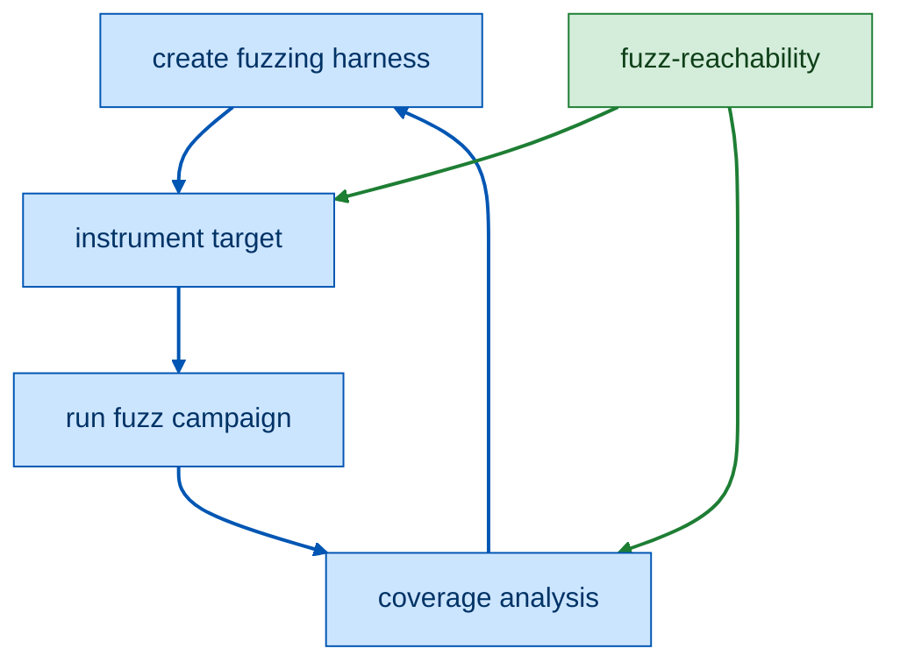

# Static Fuzz-Reachability Analyzer (C / C++ / Rust)

Given a project's build, this tool computes the set of functions that a fuzz
entry point (`LLVMFuzzerTestOneInput`, a Rust fuzz harness, or any function you
name) can statically reach. It works the same way for C, C++, Rust and mixed
projects, because it analyzes the merged LLVM bitcode.

The result is designed as an over-approximation: a function that can run for
some input should never be reported unreachable. Over-reporting is expected;
under-reporting is a bug. The known exceptions are code without bitcode, calls
made only from inline asm, function addresses computed with integer
arithmetic, callbacks registered only from unreached code, and the open issues
in [TODO.md](TODO.md). They are described under
[Limitations](docs/analysis.md#limitations).

Version: 1.2-dev

Platforms: Linux, macOS, nixOS

Author: Marc "vanHauser" Heuse

License: GNU AGPL v3 or newer

## Documentation

- [docs/usage.md](docs/usage.md): all `reachability` options, target types,
  entries, C/C++ builds, static libraries, the analyzer binary
- [docs/rust.md](docs/rust.md): Rust builds, profiles, mangling
- [docs/output.md](docs/output.md): the JSON report, the coverage lists, how
  names are joined
- [docs/analysis.md](docs/analysis.md): how the analysis works, confidence,
  function metrics, limitations
- [docs/troubleshooting.md](docs/troubleshooting.md): every error and warning,
  with its fix
- [docs/EXAMPLES.md](docs/EXAMPLES.md): complete runs on libxml2, the `url`
  crate, cpp_demangle and rustyknife
- [docs/development.md](docs/development.md): building, testing, project
  layout
- [docs/llvm-support.md](docs/llvm-support.md): supported LLVM versions

## Use in a fuzzing campaign



## How it works

```
   driver (Python)                   analyzer (C++ / LLVM)
   ───────────────                   ─────────────────────
   acquire bitcode ─┐
   C/C++ : gllvm    │
   Rust  : rustc    │   llvm-link    load .bc → build call graph →
   --emit=llvm-bc   ├─► merge .bc ─► resolve indirect calls → BFS from
                    │                entry → JSON report + coverage lists
   or, with         │
   --capture rllvm: │
   C/C++/Rust from ─┘
   one build
```

The driver builds the project so that it emits bitcode, and merges it with
`llvm-link`. With `--capture rllvm`, one build records the C, C++ and Rust
bitcode together, and `rllvm-get-bc` extracts it from the linked artifact. The
analyzer builds the call graph, resolves indirect calls by type and by
tracking where function addresses flow, and walks the graph from the entries;
see [docs/analysis.md](docs/analysis.md).

## Prerequisites

- **LLVM 21 or newer**, as one toolchain: `clang`, `clang++`, `llvm-link` and
  the analyzer share one major version, and rustc's LLVM is not newer than
  that. See [docs/llvm-support.md](docs/llvm-support.md). Distributions often
  ship old LLVM versions, so install it from https://apt.llvm.org/llvm.sh,
  especially for Rust.
- **Go** (to install gllvm), **Python 3.10 or newer**, and a **C++17**
  compiler.
  - Instead of gllvm: [rllvm](https://github.com/h1994st/rllvm) 0.7.1 or
    newer, with `--capture rllvm`; see
    [Capturing with rllvm](docs/usage.md#capturing-with-rllvm).
- For Rust targets: a nightly **rustc** and **cargo** whose LLVM is not newer
  than yours.
- [AFL++](https://github.com/AFLplusplus/AFLplusplus) from commit
  01a83a3d7098e605f0c7fd69381fcf4fc97144fe (24 June 2026) or newer.
- [cov-analysis](https://github.com/AFLplusplus/cov-analysis) from commit
  07e7afc63a54f593a377556b8f6f6144f1f7dc08 (8 July 2026) or newer.

## Install

```bash
bash scripts/setup.sh        # gllvm, optional rust-src, .venv, analyzer build
REACHABILITY_CAPTURE=rllvm bash scripts/setup.sh   # rllvm instead of gllvm
```

Or step by step: `make venv`, then `make build` (or `make build LLVM_MAJOR=23`).
`make help` lists all targets; [docs/development.md](docs/development.md) has
the details.
On NixOS, `llvm-config` and `clang++` may be in separate store paths. The build
accepts a matching `clang++` on `PATH`; set `LLVM_CONFIG` if needed to select
the desired LLVM package. `rustup` is optional, and setup skips installing
`rust-src` when it is absent.

To use the CLI, point it at the analyzer and put gllvm on `PATH`:

```bash
export REACHABILITY_ANALYZER=$PWD/analyzer/build/reachability-analyzer
export PATH="$(go env GOPATH)/bin:$PATH"     # gclang, gclang++, get-bc
source .venv/bin/activate                    # or call .venv/bin/reachability
reachability check-toolchain                 # check the LLVM versions first
```

## Quick start

```bash
reachability run --lang <target> --project <dir>
```

`<target>` is `c`, `cpp`, `rust`, `mixed`, or a Rust fuzz harness type
(`libfuzzer`, `ziggy`, `afl`). Each sets default entries, the build is
detected, and the report goes to `reachability.json` in the project, with
`reached.txt` and `not_reached.txt` next to it. All options are in
[docs/usage.md](docs/usage.md).

The default analysis includes process constructors, destructors and ifunc
resolvers as roots, so startup and shutdown code stays out of the ignorelist.
Use `--no-process-lifecycle-roots` for the narrower entry-and-callback scope.

The outputs below come from reachability 1.2-dev (commit `f5adeab`) with
LLVM 23 and rustc 1.99.0-nightly (2026-07-12). The `wrote …` lines are left
out.

**C.** `fixtures/c_direct` has a harness, two used functions and one unused:

```
$ reachability run --lang c --project fixtures/c_direct
warning: unresolved entry symbols: main
build command: make
artifact: main.o
reachable 3 / defined 4  (0 indirect-only, 0 low-confidence, 1 unreachable)  [backend=type-based]
```

`dead_fn` is in `not_reached.txt`. The warning is harmless: `c` tries both
`main` and `LLVMFuzzerTestOneInput`.

**C++ with CMake.** `examples/cpp_cmake` calls `Codec::decode` virtually:

```
$ reachability run --lang cpp --project examples/cpp_cmake
build command: cmake -S . -B build-reachability -DBUILD_SHARED_LIBS=OFF -DCMAKE_INTERPROCEDURAL_OPTIMIZATION=OFF && cmake --build build-reachability
artifact: …/examples/cpp_cmake/build-reachability/fuzz_target
reachable 13 / defined 13  (5 indirect-only, 0 low-confidence, 0 unreachable)  [backend=type-based]
$ jq -r '.reachable[] | select(.via == "indirect") | .demangled' examples/cpp_cmake/reachability.json
Raw::decode(unsigned char const*, unsigned long)
Raw::~Raw()
Xor::decode(unsigned char const*, unsigned long)
Xor::~Xor()
Codec::~Codec()
```

**Rust.** `fixtures/rust_dyn` is a `staticlib` whose `LLVMFuzzerTestOneInput`
calls through a `dyn Trait`. `--lang rust` starts from `main`, so name the
entry:

```
$ reachability run --lang rust --project fixtures/rust_dyn --entry LLVMFuzzerTestOneInput
rust bitcode: 7 crate modules
reachable 11 / defined 11  (2 indirect-only, 0 low-confidence, 0 unreachable)  [backend=type-based]
note: 8 external callees are reachable but have no bitcode body (…)
$ jq -r '.reachable[] | select(.via == "indirect") | .demangled' fixtures/rust_dyn/reachability.json
<rust_dyn::Inc as rust_dyn::Op>::run
<rust_dyn::Dbl as rust_dyn::Op>::run
```

**Mixed C and Rust.** `fixtures/mixed_c_rust` has C++ glue that calls an
`extern "C"` Rust function. `--artifact` picks the glue object:

```
$ reachability run --lang mixed --project fixtures/mixed_c_rust --artifact glue.o
build command: make
artifact: …/fixtures/mixed_c_rust/glue.o
rust bitcode: 2 crate modules
reachable 3 / defined 3  (0 indirect-only, 0 low-confidence, 0 unreachable)  [backend=type-based]
```

**Rust fuzz harnesses.** `--lang ziggy`, `afl` and `libfuzzer` build with
`cargo ziggy build`, `cargo afl build` and `cargo fuzz build`, so the bitcode
matches the binary you fuzz. `fixtures/rust_indirect` is a ziggy harness:

```
$ reachability run --lang ziggy --project fixtures/rust_indirect
note: added 1 root(s) referenced by name (dlsym/dlopen-by-name reachability): dlsym_resolved_target
rust bitcode (native build): 8 crate modules
reachable 1122 / defined 2022  (191 indirect-only, 47 low-confidence, 900 unreachable)  [backend=type-based]
```

Use `--build-cmd` for features or one binary, for example
`--build-cmd 'cargo afl build --features afl --bin afl_runner'`. See
[docs/rust.md](docs/rust.md).

## Using the results

### Instrument only reachable code

Pass the ignorelist to the build of the binary you fuzz. For AFL++'s LLVM
plugins:

```bash
export AFL_LLVM_DENYLIST=$(pwd)/not_reached.txt
make        # or meson, ninja, cmake, ...
```

For SanitizerCoverage (libFuzzer, honggfuzz, AFL++ in sancov mode):

```bash
export CFLAGS="-fsanitize-coverage-ignorelist=$(pwd)/not_reached.txt"
export CXXFLAGS="$CFLAGS"
make        # or meson, ninja, cmake, ...
```

The allowlist works the same way, with `AFL_LLVM_ALLOWLIST` or
`-fsanitize-coverage-allowlist=$(pwd)/reached.txt`. Prefer the ignorelist: the
allowlist also leaves out reachable code that had no bitcode in the analysis,
such as Rust's standard library, so that code goes uninstrumented even when the
coverage build compiles it. See
[docs/output.md](docs/output.md#allowlist-or-ignorelist).

With LTO the lists add little, because the linker already removes functions
that nothing references. On libxml2 with a libFuzzer harness, a `-flto=full` or
`-flto=thin` build kept none of the 1,134 functions in `not_reached.txt`, and
one without LTO kept 797 ([details](docs/EXAMPLES.md#step-6--compare-with-lto)).
cargo does not use full LTO by default: `lto = false` only optimizes across the
codegen units of each crate.

### Coverage analysis

[cov-analysis](https://github.com/AFLplusplus/cov-analysis) uses the report to
show which reachable functions the corpus has not reached yet, and which
functions the harness cannot reach at all:

```bash
cov-analysis report -d ../target-afl/out -e ./harness-cov -T 4 --reachability reachability.json -o cov-analysis-out
reachability verify --reachability reachability.json --coverage cov-analysis-out/coverage.json
```

Pass the actual `coverage.json` path from the cov-analysis report directory.
`verify` checks every executed function, exits nonzero if the static report
called one unreachable,
and warns about functions it cannot match. Use `--strict-unknown` to make those
warnings fail the check too. It reads existing reports and preserves them.

How it matches functions is described in
[docs/output.md](docs/output.md#how-cov-analysis-joins).
